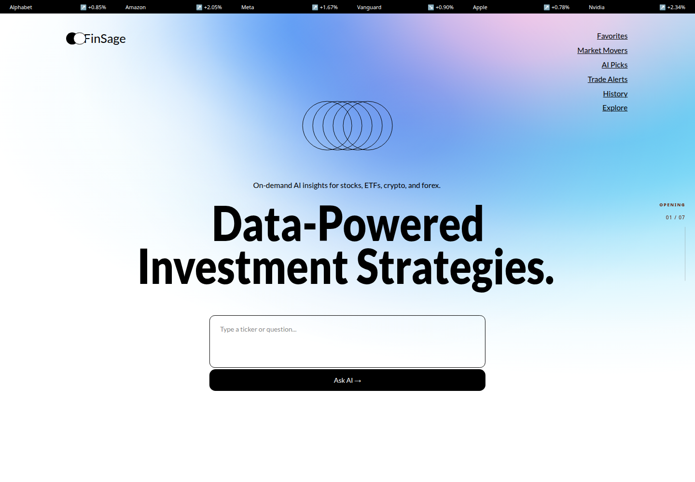
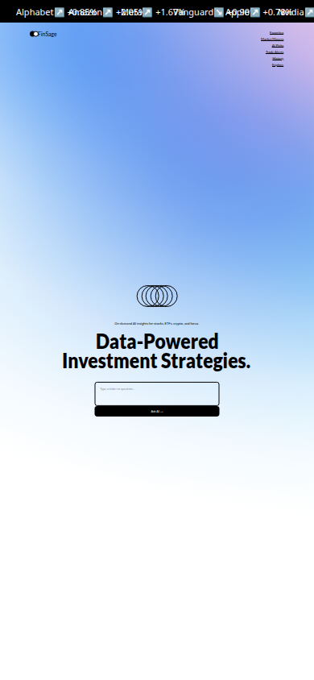

<div align="center">

# FinSage

### A cinematic fintech landing page shaped as a seven-chapter scrollytelling experience


Responsive frontend engineering · motion design · CSS/SVG artwork

**[Explore the live demo](https://meligavincent.github.io/finsage-fintech-landing/)** · [Run locally](#getting-started) · [Deploy to GitHub Pages](#github-pages-deployment)

[](https://meligavincent.github.io/finsage-fintech-landing/)

</div>

## Overview

FinSage is a frontend concept for an AI-assisted investing platform. The landing page guides the visitor through market intelligence, signal processing, an AI terminal, audience-specific solutions, educational resources, and a focused conversion sequence.

The project is built from scratch with Next.js, React, TypeScript, Tailwind CSS, and GSAP. Its visual identity relies on fluid gradients, editorial typography, orbital geometry, large monochrome surfaces, and brightly colored learning cards. Decorative artwork is implemented directly in CSS and SVG rather than through a large asset library.

> FinSage is a portfolio prototype. It is not a production financial service, and its forms and market data are demonstrative.

## Experience map

The homepage is composed as seven connected chapters:

| Chapter | Role in the story | Interaction language |
| --- | --- | --- |
| Hero | Introduces data-powered investment intelligence | staged entrance, ambient gradient, orbital geometry |
| Market Insights | Explains the signal engine and execution workflow | pinned content, pipeline progression, tab emphasis |
| Challenges | Frames complex analysis as a conversational AI terminal | terminal reveal, code-line sequencing, controls |
| Roles | Presents solutions for different market participants | role cards, InvestGPT orb, panel transition |
| Learning | Surfaces educational products and market resources | horizontal card rail and bespoke geometry hovers |
| Final CTA | Concentrates the conversion moment | panel reveal and direct action hierarchy |
| Footer | Resolves the experience into the brand | navigation columns and oversized wordmark |

A persistent chapter indicator follows the desktop journey and communicates the active section without taking over the interface.

## Highlights

- Scroll-driven storytelling built with GSAP and ScrollTrigger.
- Desktop pinning and scrubbed sequences with natural-flow mobile alternatives.
- Custom SVG constructions animated independently on pointer interaction.
- Responsive geometry based on container units, fluid spacing, and breakpoint-specific composition.
- A horizontal learning rail that remains usable on touch screens.
- A layered CSS gradient model that scales the atmospheric Hero background without distortion.
- Self-hosted Lato typography through `@fontsource/lato`.
- Reduced-motion support that keeps every section visible and readable.
- Semantic section boundaries and reusable visual primitives.
- No backend, analytics SDK, account system, or external market-data dependency.

## Technology

| Area | Choice |
| --- | --- |
| Framework | Next.js 16 App Router |
| UI runtime | React 19 |
| Language | TypeScript 5 |
| Styling | Tailwind CSS 4, CSS custom properties, container queries |
| Motion | GSAP 3 and ScrollTrigger |
| Typography | `@fontsource/lato` |
| Code quality | ESLint and the Next.js production build |
| Package manager | pnpm 10 |

## Application architecture

```text
app/
  layout.tsx                    root document and metadata
  page.tsx                      homepage composition
  globals.css                   Tailwind entry and global surface rules

components/
  hero/                         ticker, navigation, artwork and AI prompt
  insights/                     insight copy and signal pipeline
  challenges/                   terminal UI and code visualization
  roles/                        role cards and InvestGPT presentation
  learning/                     learning rail and animated SVG figures
  motion/                       page-wide GSAP orchestration
  shared/                       CTA, footer and recurring visual primitives

lib/
  motion/                       GSAP registration and motion-mode detection

public/generated/               background study asset
deployment/                     static publication script
.github/assets/                 README screenshots
```

`app/page.tsx` remains intentionally simple: it assembles the sections and mounts one motion controller. Each visual chapter owns its markup and responsive layout, while `LandingMotionController` coordinates scroll state without mixing animation timelines into the server-rendered section components.

## Motion system

The animation architecture separates three responsibilities:

1. Section components expose stable visual hooks through `data-px` and `data-motion` attributes.
2. `LandingMotionController` creates entrance, scroll, pinning, and hover timelines.
3. The motion-mode helper detects reduced-motion preferences and visual-test conditions before any choreography starts.

Desktop-only sequences are registered through GSAP media queries. Smaller screens keep normal document flow, avoiding artificial scroll lengths and pinned layouts that would feel restrictive on touch devices.

Hover choreography is enabled only for devices that actually support hover and fine pointers. Timelines are cleaned up when the controller unmounts, and decorative SVG elements return to their original geometry on pointer leave.

## Responsive strategy

<details>
<summary>View the mobile homepage</summary>



</details>

The project does not force every section into one generic wrapper. Each chapter uses the layout model that best supports its content:

- The Hero combines a fluid background plate with viewport-relative composition.
- Insight and Challenge sections become pinned narrative stages on large screens.
- Roles mixes editorial cards with a high-contrast product panel.
- Learning uses a clipped horizontal rail with fixed-ratio cards and container-relative dimensions.
- Final CTA and Footer prioritize clear content boundaries at every width.

Typography, spacing, and artwork scale through a combination of Tailwind breakpoints, `clamp()`, container query units, and explicit mobile fallbacks. Horizontal overflow is limited to intentional rails.

## Accessibility decisions

- `prefers-reduced-motion` disables nonessential choreography without hiding content.
- Decorative SVG elements are marked `aria-hidden`.
- Interactive elements use native buttons and anchors.
- The mobile experience does not depend on hover.
- Text remains part of the DOM rather than being baked into imagery.
- Section order is meaningful without JavaScript animation.

## Getting started

Requirements:

- Node.js 20.9 or newer
- pnpm 10

```bash
git clone https://github.com/meligavincent/finsage-fintech-landing.git
cd finsage-fintech-landing
pnpm install
pnpm dev
```

Open [http://localhost:3000](http://localhost:3000).

## Available commands

```bash
pnpm dev      # start the development server
pnpm lint     # run ESLint
pnpm build    # create the production build
pnpm start    # serve the standard Next.js production build
pnpm build:pages   # export a static site for the GitHub Pages project path
pnpm deploy:pages  # lint, export, and push compiled files to gh-pages
```

## Production check

Before deploying a change:

```bash
pnpm lint
pnpm build
```

The application has no required environment variables. A fresh clone can be installed and built without external credentials or services.

## GitHub Pages deployment

The public demo is hosted at **[meligavincent.github.io/finsage-fintech-landing](https://meligavincent.github.io/finsage-fintech-landing/)**.

Pages uses **Deploy from a branch** (`build_type: legacy`), with `gh-pages` and `/` as the publishing source. Next.js runs at build time; visitors receive static HTML, CSS, JavaScript, and self-hosted fonts.

```text
main (source) → pnpm build:pages → out/ → gh-pages → GitHub Pages
```

The export sets `output: "export"`, `trailingSlash: true`, and the build-time base path `/finsage-fintech-landing`. A `.nojekyll` marker preserves the `_next` assets. The regular `pnpm dev`, `pnpm build`, and `pnpm start` commands keep their standard Next.js behavior.

### Publish an update

With Node.js, pnpm, Git, and the [GitHub CLI](https://cli.github.com/) installed, authenticate `gh` with repository write access, then run:

```bash
# Commit your source changes on main first.
git push origin main
pnpm deploy:pages
```

The script lints and builds the application, copies only the export into a temporary checkout, and pushes a new commit to `gh-pages` while retaining its history. It records the source commit in `deployment.json`. Publication is manual; pushing `main` alone does not update the demo.

In **Settings → Pages**, the source must be **Deploy from a branch → gh-pages → / (root)**. GitHub completes publication after the branch push; check the Pages deployment status before considering an update live. See [GitHub's publishing-source documentation](https://docs.github.com/en/pages/getting-started-with-github-pages/configuring-a-publishing-source-for-your-github-pages-site).

### Preview the export locally

The exported site expects the repository prefix. Serve it from a parent directory with that name (Python 3 and a POSIX shell):

```bash
pnpm build:pages
preview_dir="$(mktemp -d)"
ln -s "$PWD/out" "$preview_dir/finsage-fintech-landing"
python3 -m http.server 8080 --directory "$preview_dir"
```

Open [http://localhost:8080/finsage-fintech-landing/](http://localhost:8080/finsage-fintech-landing/). Static output is served by a file server; use `pnpm start` for the standard Next.js build instead.

## Current scope

FinSage focuses on frontend craft and motion design. The AI prompt, market ticker values, navigation destinations, and calls to action are presentation-layer elements. Authentication, live quotes, portfolio data, and model inference are intentionally outside this repository.

## Design note

This implementation was authored from scratch as a frontend study inspired by supplied visual direction. It does not contain production application source code or proprietary runtime data.

---

<div align="center">
Built to explore the point where frontend engineering, motion design, and responsive storytelling meet.
</div>
